<!-- Every card is an animated SVG drawn by scripts/render_cards.py and redrawn daily by
     .github/workflows/update-cards.yml. To change what they say, edit data/profile.json.
     Spacing is baked into the SVGs: keep this block free of blank lines, and keep each
     row of three cards on one line with no spaces between them. -->

 
 
 
 
 
 

<a href="https://www.linkedin.com/in/ziad-sheashaa-89797b15b/">linkedin</a> &nbsp;/&nbsp; <a href="https://www.instagram.com/ziad._.moh/">instagram</a> &nbsp;/&nbsp; <a href="https://www.facebook.com/ziad.mohamed.gamal.792281">facebook</a> &nbsp;/&nbsp; <a href="https://discordapp.com/users/_pymage_">discord</a> &nbsp;/&nbsp; <a href="mailto:ziadmohamedgamal25@gmail.com">email</a>

